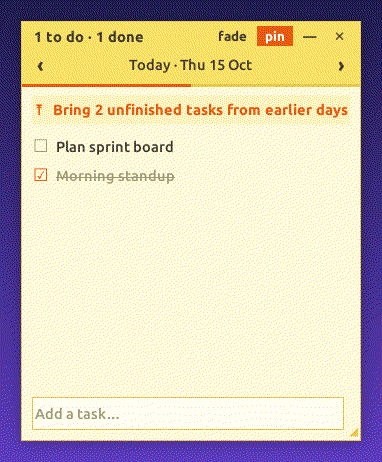
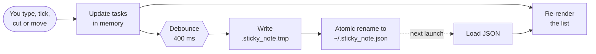

<div align="center">


<a href="https://github.com/Mahin-Abrar/sticky-note">
  
</a>

<p>
  
  
  
  
</p>



<sub>Adding a task · ticking it off · pulling in unfinished work · cut &amp; paste to tomorrow · fade mode · collapse</sub>

</div>

---

## ✨ Features

| | |
|---|---|
| 📌 **Always on top** | Floats over your editor, browser, terminal — every app. Toggle with **pin**. |
| 💾 **Autosave** | Every keystroke, tick and move is written to disk within half a second. |
| 👻 **Fade mode** | Smoothly fades to 55% opacity when your mouse leaves, and back to solid when you hover. |
| ➖ **Collapse** | Shrink the note to a single header bar showing *"3 to do · 2 done"*. |
| 📅 **Tasks per date** | Flip between days with `‹` `›`. Click the date to jump back to today. |
| ✂️ **Cut & paste across dates** | Right-click a task → **Cut**, go to any date, click **Paste**. |
| ⤒ **Carry over** | One click pulls every unfinished task from earlier days into the date you're viewing. |
| 🚀 **Starts on login** | Launches automatically every time you turn on your PC. |
| 🧩 **Zero dependencies** | One Python file. Only the standard library. |

---

## 🚀 Install

```bash
git clone https://github.com/Mahin-Abrar/sticky-note.git
cd sticky-note
python3 sticky.py
```

**Add it to the app menu and start it on every login:**

```bash
sed "s|^Exec=.*|Exec=/usr/bin/python3 \"$PWD/sticky.py\"|" sticky-note.desktop > /tmp/sticky-note.desktop
cp /tmp/sticky-note.desktop ~/.local/share/applications/
cp /tmp/sticky-note.desktop ~/.config/autostart/
```

> [!TIP]
> Don't want it on login anymore? Delete `~/.config/autostart/sticky-note.desktop`.

> [!NOTE]
> Needs Python 3 with Tkinter (`sudo apt install python3-tk` if it's missing) and an X11 session. Built and tested on Ubuntu GNOME.

---

## 🎮 Controls

| Where | Action | What happens |
|---|---|---|
| Header | Drag | Move the note |
| `◢` corner | Drag | Resize |
| **pin** | Click | Toggle always-on-top |
| **fade** | Click | Toggle fade-when-idle |
| **—** | Click | Collapse / expand |
| **✕** | Click | Save and close |
| `‹` `›` | Click | Previous / next day |
| Date | Click | Jump to today |
| Bottom box | Type + <kbd>Enter</kbd> | Add a task |
| `☐` | Click | Tick off (moves to the bottom, crossed out) |
| Task text | Click | Edit in place |
| Task row | Right-click | Cut · Move to next day · Move to today · Delete |

---

## 🧠 How it works

Everything lives in [`sticky.py`](sticky.py) — about 300 lines of plain Tkinter.



### 💾 Saving without a save button
Every change calls `schedule_save()`, which restarts a 400 ms timer. When you stop typing, the timer fires and the whole state is written as JSON to a temp file, then swapped in with `os.replace()`. That rename is atomic, so even a crash or power cut mid-save can't leave you with a half-written, corrupted file.

### 🗂️ The data file
All state lives in `~/.sticky_note.json` — outside the repo, so your tasks never get committed:

```json
{
  "tasks": {
    "2026-10-15": [
      { "text": "Ship the README", "done": false },
      { "text": "Morning standup", "done": true }
    ]
  },
  "clip": [],
  "settings": { "size": "340x420", "pos": "+300+200", "on_top": true, "faded": false }
}
```

Tasks are grouped by ISO date, so "earlier days" is a simple string comparison. `clip` holds cut tasks — saved too, so they survive a restart. Empty days are pruned on save.

### 🪟 A borderless window that still takes typing
The note uses the window type `splash`. GNOME draws no title bar for it, but — unlike a fully unmanaged `overrideredirect` window — it still gets keyboard focus and respects *always on top*. The header, drag-to-move and resize grip are all drawn by the app itself.

### 👻 The fade
A loop checks every 200 ms whether the mouse is over the note. When it needs to change opacity, it switches to 15 ms steps of 6%, giving a smooth ~100 ms fade instead of a jarring jump.

### 🔒 Only one note at a time
On launch the app takes an exclusive `flock` on `~/.sticky_note.lock`. A second launch can't get the lock, so it drops a tiny `~/.sticky_note.raise` file and exits. The running note spots that file on its next check and jumps to the front. So clicking **Sticky Note** in the app menu either opens the note or brings it back.

### ⤒ Carrying tasks over
Pick any date and the app counts unfinished tasks on every earlier date. If there are any, a button appears; clicking it moves them all into the current day and leaves finished ones where they were, as a record.

---

<div align="center">

**Made with 🧡 and zero dependencies**


</div>
